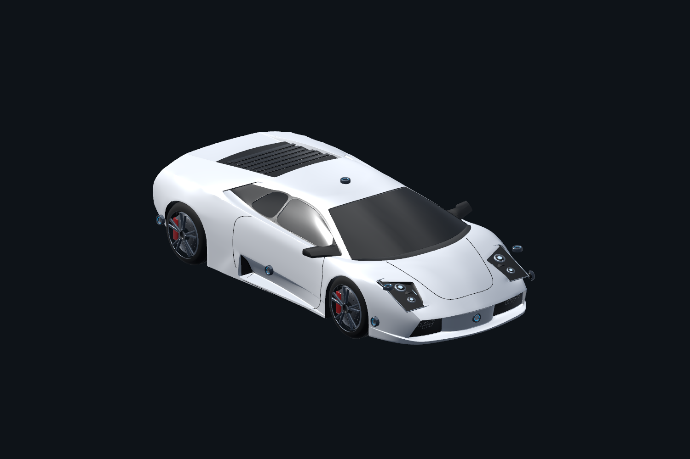

# Flying Lambo

Drive, launch and fly a miniature white Lamborghini around your room in mixed reality on **Meta Quest 3**. Use an **Xbox controller** to coast in zero gravity, fire directional thrusters, and land on your floor or furniture.

*Unity render of the current in-game vehicle. Adapted from Ajay Gawde's [Lamborghini Murcielago LP-640](https://sketchfab.com/3d-models/lamborghini-murcielago-lp-640-low-poly-1822aaadc6f34060a38ddf46f0c84ec3), licensed under [CC BY 4.0](https://creativecommons.org/licenses/by/4.0/). See [credits and modifications](CREDITS.md).*

**[Download the Quest APK](https://github.com/chimph/flying-lambo/releases/download/v0.1.0/FlyingLambo.apk)** · [Releases](https://github.com/chimph/flying-lambo/releases) · [Development guide](docs/DEVELOPMENT.md)

## What you can do

- Drive on scanned surfaces with acceleration, braking, reverse, steering and a handbrake.
- Launch into zero gravity. Momentum persists until you apply thrust or hit something.
- Translate and rotate using 17 physical thruster ports, with visible exhaust.
- Press **A** in flight to brake, level and hold position using finite thruster forces.
- Place a landing pad on a clear, horizontal surface and practise precision landings.
- Press **View** to hide **all in-game text**, including the HUD, pad labels and pause messages.

The car is about **27 cm long**, with pearl-white paint, detailed wheels and brakes, projector lamps, panel seams and cooling grilles. Room data supplies invisible collision geometry and landing surfaces.

## Play on Quest 3

1. Enable Quest developer mode, connect the headset by USB, and accept USB debugging.
2. Download `FlyingLambo.apk` from the release above. Install it with Meta Quest Developer Hub or `adb install -r FlyingLambo.apk`.
3. Pair an Xbox controller to the headset over Bluetooth.
4. Complete the headset's room setup, including the furniture you want to use. Launch **Flying Lambo** from Unknown Sources and allow spatial-data access.
5. The car starts on a clear surface in front of you. Drive with the triggers and left stick, or press **Y** to launch. Press **Menu** to resume after a system dialog if needed.

### Xbox controls

| Control | On the ground | In flight |
| --- | --- | --- |
| Left stick | Steer | Forward/backward and sideways thrust |
| Right stick | — | Pitch and yaw |
| RT | Accelerate | Upward thrust |
| LT | Brake, then reverse | Downward thrust |
| LB / RB | — | Roll |
| A | Hold for handbrake | Toggle stop, level and position hold |
| B | Toggle spin damping | Toggle spin damping |
| Y | Launch | — |
| Hold X | Reset | Reset |
| Menu | Pause/resume | Pause/resume |
| View (overlapping squares) | Show/hide all text | Show/hide all text |
| D-pad down | Place a pad where you look | Place a pad where you look |
| D-pad up | Reload scanned room | Reload scanned room |

Manual flight input cancels position hold. Thrust follows the car's local axes; rotating it does not rotate its existing momentum. A gentle, upright underside contact restores Earth gravity for driving. When paused with text visible, D-pad left/right open the model source/license.

## Build and develop

Use **Unity 6000.6.0f1** with **Android Build Support, SDK/NDK and OpenJDK**. Open the `Unity` folder in Unity Hub; Unity restores the pinned Meta XR, MR Utility Kit, OpenXR and Input System packages.

- **Editor:** open `Assets/AstroQuest/Scenes/TestRoom.unity` and press Play. A gamepad or keyboard works.
- **Quest:** choose **Flying Lambo → Build Quest APK**. The APK is written to `Builds/FlyingLambo.apk` at the repository root.
- **Physics checks:** run the Play Mode tests in Unity Test Runner, or `bash scripts/unity.sh test`.
- **Vehicle:** edit `Art/AstraLP640_HD.blend` in Blender. The exported FBX and textures are already included; Blender is optional for building the game.

See the [development guide](docs/DEVELOPMENT.md) for keyboard controls, command-line builds, the art pipeline and verification details. The existing `AstroQuest` code namespace, asset paths and Android package ID are retained for compatibility with earlier prototypes.

## Notes

Flying Lambo is a small, free game to download and enjoy as-is. All ten physics tests pass, covering inertial flight, launch/landing, stop-and-level, ground driving, pause recovery and landing-pad placement. See the [development guide](docs/DEVELOPMENT.md#verification) for validation details and remaining device checks.

Visual depth occlusion is not implemented: furniture can collide with the car while still being drawn behind it in passthrough. Room geometry comes from the saved scan and does not continuously follow moved objects. Sound, collision damage and landing scores are not implemented.

Issues and contributions are welcome. Include your headset/OS version, controller, reproduction steps and screenshots when reporting a problem.

## License and credits

Original project code is available under the [MIT license](LICENSE). The Lamborghini model, its adapted vehicle assets, textures and vehicle images are **CC BY 4.0**, attributed to **Ajay Gawde**; see [CREDITS.md](CREDITS.md). Unity and Meta packages retain their own licenses and are restored through Unity Package Manager.

This is an independent game project, unaffiliated with Lamborghini, Tesla or Meta.
